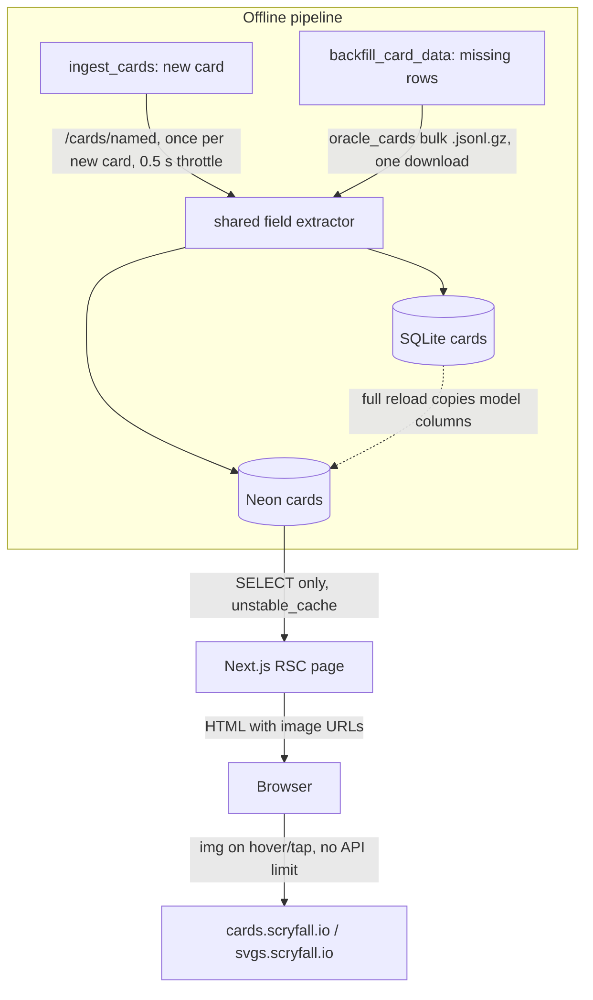
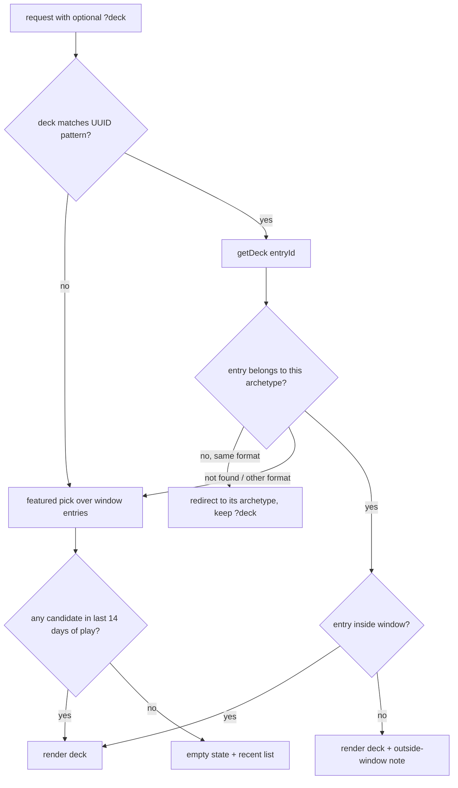

# Archetype Decklists Tab - Plan

## Goal Capsule

- **Objective:** A player who opens an archetype page sees a real, recent, strong decklist for it, readable like a paper list (grouped by type, mana costs, card image on hover/tap). They can browse every other recent list of that archetype in one click.
- **Means:** Card data persisted once per card on `cards` (KTD1), read by the web with no runtime Scryfall calls. A points-based featured pick (KTD4) plus a recent-decks column driven by `?deck=` (KTD6).
- **Authority:** This plan's Requirements win on product behavior. KTDs win on mechanism. The origin doc (`docs/brainstorms/2026-09-27-decklist-by-type-requirements.md`) is superseded only where this plan says so. KTD5 keeps the origin's bucket priority and overrides only an advisor's Creature-first suggestion.
- **Stop conditions:** Stop and ask if a full SQLite→Postgres reload is needed to land the schema, or if the Scryfall bulk file can no longer be keyed by `oracle_id`.
- **Execution profile:** Python pipeline first (U1, U2), then the web contract (U3, U4), pure logic (U5), UI (U6), page wiring (U7).
- **Tail ownership:** Running the migration and backfill against Neon is an operator step (see Documentation / Operational Notes). The implementer prepares and dry-runs it; the user runs it against production.

---

## Product Contract

### Summary

Replace the archetype page's Decklists tab with a featured decklist and a recent-decks column.
The featured deck is the archetype's best match-points result in its last 14 days of play.
The deck renders grouped by card type with mana costs and a card image preview on hover, focus, or tap.
The right column lists every deck of the archetype in the window, newest first, and swaps the shown deck.
The old per-card adoption tables move into a collapsed "Card breakdown" section.
Card data comes from new columns on `cards`, fetched from Scryfall at most once per card (concurrent ingest runs excepted, per R14).

### Problem Frame

The Decklists tab shows only aggregate adoption tables (avg copies, decks, presence). A user who clicks an archetype wants to see what a list looks like and what is winning now. The tables do not answer that. Card names are also mis-cased ("Blade Of The Bloodchief", "Soul-guide Lantern") because the DB stores lowercase names and the web title-cases them naively.

The DB holds every deck we need (`deck_cards` per `tournament_entries` row) but no card type, mana cost, proper-case name, or image. The origin doc already chose to persist these on `cards` and backfill from Scryfall bulk data.

### Requirements

**Featured deck**
- R1. The Decklists tab opens on one featured deck chosen by match points, per KTD4. Its header is labelled "Featured — most match points, last 14 days of play".
- R2. The deck header shows event name, date, player, placing (MTGO rank when present) or W-L-D record, and a link to the source decklist (fallback: the event link).
- R3. The maindeck renders grouped by card type in the order Creatures, Planeswalkers, Battles, Instants, Sorceries, Artifacts, Enchantments, Lands, Other. Each header shows its summed count (see origin).
- R4. A multi-type card appears once, bucketed by the priority Land > Creature > Planeswalker > Battle > Artifact > Enchantment > Instant > Sorcery, using the front-face type line (see origin).
- R5. Each card row shows count, proper-case name, and mana-cost symbols. Cards without stored type data render in an "Other" group with a title-cased name.
- R6. The sideboard renders as one flat list. In Duel Commander it is labelled "Commander".

**Card preview**
- R7. Hovering or keyboard-focusing a card name shows the Scryfall `normal` image. On touch devices a tap shows it. A double-faced card shows both faces, side by side on desktop and stacked on mobile. A card with no stored image renders as plain text with no preview.
- R8. Preview images load only when opened, in a card-sized box that reserves its aspect ratio while loading. They never cause a Scryfall API call.

**Recent decks**
- R9. A recent-decks column lists the archetype's decks in the window, newest first, grouped by event, up to the cap in R12. Each row shows player and placing or record. The featured deck's row carries a "Featured" tag. A deck without a published list shows as plain text tagged "no list published".
- R10. Selecting a recent deck shows it in place of the featured deck, with a "Back to featured" link. The selection is part of the URL and survives tab switches, slug redirects, and paging.
- R11. A shared deck link keeps working after the window moves on and after the deck is reclassified. When the deck lies outside the current window, the page says so. When it now belongs to another archetype, the page redirects to that archetype with the selection kept.
- R12. The list shows the 50 newest decks and offers a "Show older decks" control, up to 2,000 decks. Past the cap, the list ends with "Showing the newest 2,000 of N decks" and the control disappears.

**Layout**
- R16. On desktop, the deck panel takes about two thirds of the width and the recent-decks column one third. Inside the deck panel, non-land groups flow in the left column; Lands, then Sideboard or Commander, in the right. Groups never split across columns. The Card breakdown sits full width below. On mobile everything is one column, and the recent decks collapse into an "Other decks (N)" control above the deck.
- R17. On mobile, picking a deck closes the "Other decks" control and scrolls to the deck header. While a swap is pending, the current deck stays visible (dimmed) and the format-level spinner never replaces the page.

**Card breakdown**
- R13. The aggregate adoption tables (main and side) stay available in a collapsed "Card breakdown" section with proper-case names.

**Card data**
- R14. Scryfall card data (proper-case name, front-face type, mana cost, cmc, image URLs, Scryfall link) is stored per card. Each card is fetched from Scryfall at most once, small duplicates from concurrent ingest runs excepted.
- R15. The web request path makes no Scryfall API calls.

### Key Decisions

- **Featured deck = most match points in the archetype's last 14 days of play.** (session-settled: user-directed — chosen over "most recent Top 8 at an event with ≥24 decklists": Top 8s at unequal events mean unequal things; points are simple.) Governs R1.
- **No derived placings for Melee.** (session-settled: user-directed — chosen over ranking Melee entries by match points: placement accuracy does not matter for this page; listing every deck by recency does.) Governs R2, R9.
- **The old adoption tables become a collapsed section.** (session-settled: user-directed — chosen over keeping them as a visible "Card breakdown" below the deck: they are secondary to the decklist.) Governs R13.
- **Card data is persisted per card in the DB.** (session-settled: user-directed — chosen over a web-side lazy Scryfall cache: a cache refetches on expiry and risks 429s on a cold start.) Governs R14, R15.

### Scope Boundaries

- The Matchups, Trends, and Performance tabs are unchanged.
- No prices, no "visual view" (card grid), no buy buttons.
- No computed "typical / aggregate decklist" (origin scope note (b)). Deferred.
- No change to how the page 404s when an archetype has zero matches in the window.

#### Deferred to Follow-Up Work

- Tournament page player view (`docs/brainstorms/2026-09-27-tournament-page-requirements.md`) reuses the decklist component and `getDeck`. Not built here.
- OpenGraph image for a specific `?deck` (STRATEGY.md "Shareable distribution").
- Aggregate "typical list" (cards in ≥50% of decks at modal count).
- Periodic image-URL refresh using Scryfall `/cards/manifest`.

### Sources

- Origin: `docs/brainstorms/2026-09-27-decklist-by-type-requirements.md` (type order, bucket priority, Option A data plan).
- Scryfall rate limits: https://scryfall.com/docs/api/rate-limits. `/cards/named` and `/cards/collection` allow 2 req/s. `*.scryfall.io` has no rate limit.
- Scryfall bulk data: https://scryfall.com/docs/api/bulk-data. JSONL.gz only since 2026-07-20, regenerated daily.
- Scryfall layouts: https://scryfall.com/docs/api/layouts.
- Institutional learning: `docs/solutions/performance-issues/archetype-pages-correlated-subquery-latency.md` (no correlated per-row subqueries on Neon).

---

## Planning Contract

### Key Technical Decisions

- KTD1. **New nullable columns on `cards`, written only by the offline pipeline.** Columns: `display_name` (plain `String`, because `CaseInsensitiveText` lowercases on every write), `type_line` (front face), `mana_cost`, `cmc`, `image_normal` (front), `image_back` (back face, nullable), `scryfall_uri`, `scryfall_id` (printing). Governs R14, R15. (session-settled: user-directed — chosen over web-side lazy cache, build-time JSON, and a separate oracle-keyed sync table: only DB columns give fetch-once with zero runtime calls and fill new cards at creation.) `scripts/migrate_tournament_to_postgres.py` derives COPY columns from the model, so a full reload carries the columns once both DBs are migrated.
- KTD2. **One pure field extractor shared by ingest and backfill.** It maps one Scryfall card object to the KTD1 fields:
  - Use top-level `image_uris` when present (normal, split, adventure, flip, prototype, meld parts).
  - Otherwise use `card_faces[0]` and `card_faces[1]` images (transform, modal_dfc, battle).
  - Type line and mana cost come from `card_faces[0]` when faces exist, except split cards, which keep the full top-level `mana_cost` (e.g. `{R} // {2}{R}`).
  - `display_name` is Scryfall's top-level `name`.

  One extractor means ingest and backfill can never disagree.
- KTD3. **Fetch-once mechanics.**
  - **New cards:** filled at creation from the `/cards/named` response ingest already fetches. Zero extra calls.
  - **Printing:** the stored image is Scryfall's default printing (its "most recent recognizable" print), which is what both `/cards/named` and `oracle_cards` return. (session-settled: user-directed — chosen over the original printing: no extra printing-selection logic.)
  - **Existing cards:** filled by a backfill from the `oracle_cards` bulk file, a single download from `data.scryfall.io`, which has no rate limit. One bulk-data metadata request per run (none with a local file); no per-card API calls.
  - **Backfill pre-flight:** before writing, the backfill checks the file has the required fields (`name`, `type_line` or `card_faces`, image URIs) on at least 99% of matched cards, and that double-faced cards carry per-face images. Otherwise it aborts without writing.
  - **Backfill scope:** writes only rows where `type_line` is null, unless `--refresh` is given. Keyed on `scryfall_oracle_id`.
  - **Images are not stored, only their URLs.** Browsers fetch them from `cards.scryfall.io`, which Scryfall documents as having no rate limit and serves with `cache-control: public, max-age=31556952` (verified 2026-10-11). Each visitor downloads a card image at most once a year.
  - **Concurrency:** there is no request-path writer, so concurrent ingest runs are the only possible duplicate fetch.
  - **Ingest throttle:** raise `SCRYFALL_REQUEST_DELAY` from 0.1 s to 0.5 s to honor the 2 req/s `/cards/named` limit.
- KTD4. **Featured selection is a pure function over the archetype's window entries.** It instantiates the featured-deck Key Decision (session-settled: user-directed, governs R1).
  - **Candidates:** entries that have deck cards, with a tournament date (UTC calendar day) from 13 days before the anchor through the anchor, inclusive. The anchor is the newest tournament date among the archetype's entries with deck cards in the window, not today.
  - **Score:** 3·wins + draws, with nulls as 0.
  - **Ties:** newest date, then lower nonzero rank (0 sorts last), then lower entry id.
  - **Fallback:** no candidates means no featured deck. Show an empty state.
  - **Known bias:** MTGO records count only matches vs other published decks, so a large Melee event usually outscores a Challenge in the same fortnight. Accepted.
- KTD5. **Type bucketing follows the origin priority, Land first.** Dryad Arbor and Darksteel Citadel go to Lands. This supersedes the session advisor's Creature-first suggestion, because the origin doc is the user's recorded choice. Bucketing reads the front-face `type_line`, never `is_land`, which is wrong for spell//land MDFCs.
- KTD6. **`?deck=<entryId>` resolves by entry id plus archetype, ignoring the window.**
  - **Validation:** the value is checked against a UUID pattern before any data call, so garbage values cannot grow the cache.
  - **Other archetype, same format:** redirect to that archetype's page, keeping `deck` (parser reruns reclassify entries in place). Unknown id or other format: fall back to the featured deck.
  - **Outside the window:** render it with a note.
  - **Persistence:** `deck` rides in tab links, the stale-slug redirect, and the "Show older decks" link. Recent-deck links keep the current `decks` value.
  - **SEO:** `deck` and `decks` are excluded from the canonical URL, like `?row` today, so SEO consolidates on the archetype page.
- KTD7. **Two new cached data-source methods, separate from `getArchetypeDetail`.**
  - **`getArchetypeEntries(q & slug)`:** returns light rows for the archetype's window entries, newest first, capped at 2,000 with a total count (R12 owns what the user sees past the cap). It is keyed on the window, like the other archetype reads.
  - **`getDeck({ format, entryId })`:** returns one entry's header plus its cards with KTD1 fields. It is keyed on the entry id only, so it is reusable by the tournament page.
  - **Why separate:** `deck` never enters the `MetaQuery`, so it never duplicates the matchups/trends cache entries.
- KTD8. **Recent-decks paging in the URL.** `?decks=<n>` shows the newest 50·n entries. The page slices the cached list, so the RSC payload carries only the rendered rows. No API route or client fetching.
- KTD9. **Card preview is one small client component.** It opens on pointer hover and keyboard focus, toggles on tap for touch pointers, and closes on Escape or an outside tap. It is built on the existing Radix Popover (the tap-capable pattern from `LensBar/WindowPicker.tsx`). The popover content never takes focus (Radix open/close auto-focus suppressed), so Tab moves straight to the next card name and closes the previous preview. The image alt is the card name (both face names for a double-faced card). The image uses a plain `img` with lazy loading, not `next/image`, so it does not spend Vercel image-optimization quota.
- KTD10. **Mana symbols from `svgs.scryfall.io`.** A pure parser maps `{W/U}`→`WU.svg`, `{2/W}`→`2W.svg`, `{W/P}`→`WP.svg`. Each symbol image's alt is its brace text (e.g. `{W/U}`), and the ` // ` separator of split cards stays visible text. The CDN has no rate limit and needs no new dependency. Unknown symbols render as text.
- KTD11. **Card names use the stored `display_name` everywhere, with a better title-case fallback.** `CARD_ADOPTION_SQL` selects `coalesce(display_name, name)`. The fallback keeps small words lowercase and capitalizes after hyphens. It replaces the naive helper in `CardAdoptionTable`.
- KTD12. **Fixtures carry synthetic entries and decks.** `gen-fixtures.ts` emits up to 8 entries per archetype per window, with lists built from the archetype's adoption pools. Card data for fixture card names is resolved once at generation time via Scryfall `/cards/collection` by name (the generator already calls Scryfall for art). The runtime fixture backend stays offline.

### High-Level Technical Design

Card data lifecycle (who calls Scryfall, and when):

Deck selection on the Decklists tab:

### Assumptions

- Every `cards` row has a `scryfall_oracle_id` (verified 13,826/13,826 on 2026-10-11), so the bulk backfill can key on it.
- `reversible_card` objects lack a top-level `oracle_id`. The backfill skips them, matching `wanted()` in `scripts/update_card_colors.py`.

---

## Implementation Units

### U1. Card data columns and ingest fill

**Goal:** `cards` carries KTD1 fields, and ingest fills them for every newly created card.

**Requirements:** R14, R15. KTD1, KTD2, KTD3.

**Dependencies:** none.

**Files:**
- `src/models/reference.py` (Card columns)
- `alembic/versions/<new>_card_scryfall_display_fields.py`
- `src/ingest/scryfall_fields.py` (new, shared extractor)
- `src/ingest/ingest_cards.py` (use extractor in `get_or_create_card`; raise `SCRYFALL_REQUEST_DELAY`)
- `tests/test_scryfall_fields.py` (new)
- `tests/test_ingest_cards_card_data.py` (new)
- `scripts/migrate_tournament_to_postgres.py` (stamp pre-flight)
- `tests/test_schema_bootstrap.py`

**Approach:**
1. Add the nullable columns. `display_name` is a plain `String(200)`, like `Player.handle`.
2. Write the migration with `op.batch_alter_table`, following `1a604eff3d98_is_land_card_type.py`. The upgrade contains only `add_column` operations, preceded on the postgresql dialect by `SET LOCAL lock_timeout` (mirror `DDL_LOCK_TIMEOUT` in `scripts/migrate_tournament_to_postgres.py`). Strip any autogenerated `alter_column` (e.g. `is_land` server-default drift), because on SQLite it forces a `cards` table rebuild under `PRAGMA foreign_keys=ON`, which cascades into `card_colors` and is blocked by `deck_cards`.
3. Pass the extractor's output into the `Card(...)` constructor. Do not change the three early-return paths. Existing cards are the backfill's job (U2).
4. Harden `bootstrap_schema` in `scripts/migrate_tournament_to_postgres.py`: refuse to `alembic stamp head` when the target's `cards` columns differ from the model. Otherwise a reload against an unmigrated Neon stamps the new revision without adding the columns.

**Patterns to follow:** `derive()` in `scripts/update_card_colors.py` for front-face handling. The `sys.path` and `create_all` test style in `tests/test_ingest_deck_cards.py`.

**Test scenarios:**
- A normal card (Lightning Bolt shape) yields name, type line, `{R}`, cmc 1, front image, no back image.
- A transform/MDFC card (no top-level `image_uris`) yields the front-face type and cost, plus front and back images.
- A split card yields the full `"{R} // {2}{R}"` cost, the front type, and the top-level image.
- An adventure card yields the top-level image and the creature front type.
- A card missing every optional field yields nulls without raising.
- `get_or_create_card` with a mocked `/cards/named` response creates a row with all KTD1 fields populated.
- `get_or_create_card` for an already-known card makes no Scryfall call and leaves the row unchanged.
- Schema bootstrap (`tests/test_schema_bootstrap.py`) still passes with the new columns.
- The stamp pre-flight refuses a target whose `cards` table lacks a model column and names the missing columns.

**Verification:** Python CI (ruff plus pytest) is green. Upgrading a copy of `data/tournament.db` leaves `cards`, `deck_cards`, and `card_colors` row counts unchanged.

### U2. Bulk backfill script

**Goal:** Every existing card gets KTD1 fields from one bulk download, with no per-card API calls.

**Requirements:** R14. KTD2, KTD3.

**Dependencies:** U1.

**Files:**
- `scripts/backfill_card_data.py` (new)
- `tests/test_backfill_card_data.py` (new)
- `src/ingest/README.md` (operator section)

**Approach:**
1. Read cards through `iter_cards()` from `scripts/update_card_colors.py`, which already uses `jsonl_download_uri`. It also accepts a local `.jsonl.gz`.
2. Index the file by `oracle_id`, skipping objects without one. Run the KTD3 pre-flight on the matched set before any write.
3. Update matching rows in batches, committing per chunk. Each row's eight fields are written in one statement, because `type_line` is the "done" marker. The default filter is `type_line IS NULL`, so an interrupted run resumes where it stopped. `--refresh` rewrites all rows.
4. Print counts of matched, updated, and unmatched rows. Support `--dry-run`, and target either DB through the existing `TOURNAMENT_DATABASE_URL` resolution.

**Patterns to follow:** `scripts/migrate_card_land.py` (re-runnable only-missing backfill). `tests/test_update_card_colors.py` (importlib loading, hand-built Scryfall dicts, no network).

**Test scenarios:**
- Given a two-card JSONL fixture and a SQLite DB with those oracle ids and null fields, both rows are filled.
- A row that already has `type_line` is untouched without `--refresh` and rewritten with it.
- An oracle id in the DB but absent from the file is reported as unmatched and left null.
- A `reversible_card` object without an `oracle_id` is skipped without error.
- `--dry-run` reports counts and writes nothing.
- Running twice in a row: the second run updates zero rows.
- A run interrupted after the first chunk leaves committed rows filled. A rerun fills only the rest.
- A file where most matched cards lack `type_line` and `card_faces` fails the pre-flight and writes nothing.

**Verification:** A dry run against `data/tournament.db` reports roughly 13.8k matches and a small unmatched count.

### U3. Data-source contract and Postgres implementation

**Goal:** The web can read window entries and a single deck with card data.

**Requirements:** R2, R5, R9, R11, R13, R15. KTD7, KTD11.

**Dependencies:** U1. Neon must carry the columns before any preview or production deploy of this unit. `CARD_ADOPTION_SQL` reads `display_name`, so an unmigrated Neon breaks every archetype page, not only the new tab, and Vercel previews read production Neon.

**Files:**
- `web/src/datasource/types.ts` (entry, deck, and deck-card DTOs; two interface methods)
- `web/src/datasource/postgres/sql.ts` (entries SQL, deck SQL, `display_name` in `CARD_ADOPTION_SQL`)
- `web/src/datasource/postgres.ts`
- `web/src/datasource/index.ts` (cache wrappers)
- `web/src/datasource/__tests__/postgres.helpers.test.ts`
- `web/src/datasource/__tests__/index.test.ts`

**Approach:**
1. **Entries SQL:** one pass over window entries of the archetype, joined to tournaments and players. Include a `has_cards` flag from a grouped join on `deck_cards`, not a correlated subquery (see Sources learning). Order newest first and cap at 2,000.
2. **Deck SQL:** one entry's header (tournament, player, rank, record, URLs, archetype slug, format) plus its `deck_cards` joined to `cards`. It returns the entry's current archetype so the page can redirect per KTD6.
3. **Adoption SQL:** `CARD_ADOPTION_SQL` selects `coalesce(c.display_name, c.name)` and groups by `dc.card_id, c.id` (the cards primary key), or Postgres rejects the coalesce.
4. **Mapping:** keep row-to-DTO mapping in small pure helpers so they can be tested without a DB.
5. **Caching:** wrap both methods in `unstable_cache` with the `archetype` tag. `getDeck` is keyed on entry id only.

**Patterns to follow:** the `TOURNAMENTS_SQL` CTE hoist. The `asIso` date mapping. The `withCache` method shape.

**Test scenarios:**
- The entry-row mapper turns a raw row with rank 0, null `decklist_url`, and a tournament link into a DTO with no rank and the event link as source.
- The deck mapper groups raw card rows into main and side and keeps null card-data fields as null.
- The `CardAdoptionDTO` name prefers `display_name` and falls back to the lowercase name.
- The cache wrapper exposes both new methods and keys `getDeck` independently of the window.

**Verification:** `pnpm test` and `tsc` are green. Against Neon (after U1/U2 ops), a Broodscale window returns entries and a deck whose cards carry type lines.

### U4. Fixture backend parity

**Goal:** Fixtures mode (the default, and CI) renders the new tab with realistic data.

**Requirements:** R1–R13 in fixtures mode. KTD12.

**Dependencies:** U3.

**Files:**
- `web/scripts/gen-fixtures.ts`
- `web/scripts/gen-fixtures.specs.ts` (if pools need fixing)
- `web/src/datasource/fixtures.ts`
- `web/src/datasource/fixtures/data/db.json` (regenerated)
- `web/src/datasource/__tests__/stats.snapshot.test.ts`

**Approach:**
1. Emit up to 8 entries per archetype per window, with lists sampled from adoption pools. Entry ids are deterministic UUID-shaped strings (seeded hex, 8-4-4-4-12), so `?deck` passes KTD6 validation in fixtures mode.
2. Emit a global card-data map keyed by fixture card name, resolved once at generation time. Replace `gix flatterer` in the B color pool with a real card (the only pool name Scryfall cannot find). The generator fails when `/cards/collection` returns any `not_found`.
3. Implement both new methods in `FixtureDataSource`.

**Patterns to follow:** seeded RNG helpers and art fetch in `gen-fixtures.ts`.

**Test scenarios:**
- Fixture `getArchetypeEntries` for a seeded archetype returns entries newest first with deterministic ids.
- Every fixture entry id passes `parseDeckId`.
- Fixture `getDeck` for a seeded constructed archetype returns a 60/15 list whose cards carry type lines.
- `getDeck` with an unknown id returns null.
- The existing meta-report snapshot is unchanged.

**Verification:** `pnpm test` is green. `pnpm dev` without `DATA_SOURCE` renders a featured deck.

### U5. Pure deck logic and URL params

**Goal:** All selection, grouping, and formatting rules live in tested pure functions.

**Requirements:** R1, R3–R6, R10–R12. KTD4, KTD5, KTD6, KTD8, KTD10, KTD11.

**Dependencies:** U3 (DTO types).

**Files:**
- `web/src/lib/decks.ts` (new: featured pick, event grouping, paging slice, type bucket, card sort, record/placing label)
- `web/src/lib/mana.ts` (new: mana-cost symbol parser)
- `web/src/lib/card-names.ts` (new: title-case fallback)
- `web/src/lib/params.ts` (`deck` and `decks` opts in `BuildHrefOpts`; `parseDeckId`; `parseDecksPage`)
- `web/src/lib/__tests__/decks.test.ts`
- `web/src/lib/__tests__/mana.test.ts`
- `web/src/lib/__tests__/card-names.test.ts`
- `web/src/lib/__tests__/params.test.ts`

**Approach:** Bucketing returns a fixed-order list of groups with summed counts. Within a group, sort by cmc, then name. Sideboard sort is count descending, then name. Emit `deck` after `tab` in `buildHref`'s fixed param order.

**Patterns to follow:** `parseRow` validation and its round-trip tests. `MatchupList.test.ts` pure-helper style.

**Test scenarios:**
- **Featured, happy path:** the highest 3W+D in the 14-day window wins over an older higher-point entry.
- **Featured, boundary:** an entry dated exactly 13 days before the anchor is a candidate; one dated 14 days before is not.
- **Featured, anchor:** an archetype whose newest entry is 20 days before window end still gets a pick.
- **Featured, ties:** equal points go to the newer date. Same date goes to rank 3 over rank 0, then to the lower entry id.
- **Featured, empty decks:** an entry without cards is never picked.
- **Featured, no candidates:** returns null.
- **Bucketing:** "Artifact Creature — Construct" → Creatures. "Land Creature — Forest Dryad" → Lands. "Instant // Land" front face "Instant" → Instants. Null type → Other. Group counts sum the copies.
- **Mana:** `{2}{W/U}{W/P}` → `2`, `WU`, `WP` symbol files. `"{R} // {2}{R}"` keeps the separator. Null → nothing.
- **Names:** "blade of the bloodchief" → "Blade of the Bloodchief". "soul-guide lantern" → "Soul-Guide Lantern". "emrakul, the promised end" → "Emrakul, the Promised End". "urza's saga" keeps "Urza's".
- **Labels:** rank 1 → "1st". Rank 0 with 5-1-0 → "5-1-0". Rank 0 with 0-0-0 → no label.
- **Params:** `parseDeckId` accepts a UUID and rejects `../x`, empty, and over-length input. `buildHref` round-trips `deck` and `decks` together. `decks=1` is omitted as the default. `decks=0` or junk clamps to 1.
- **Paging:** `decks=2` slices 100 rows. Event grouping keeps newest-first order across events.
- **Cap:** with 2,000 loaded rows and a total of 3,041, the last page reports "newest 2,000 of 3,041" and offers no further page.

**Verification:** `pnpm test` is green with the new suites.

### U6. Decklist UI components

**Goal:** Reusable server-rendered decklist, recent-decks column, and card preview.

**Requirements:** R1–R9, R12, R13, R16, R17. KTD9, KTD10.

**Dependencies:** U5.

**Files:**
- `web/src/components/decklist/DecklistView.tsx` (RSC: header, type groups, sideboard/commander)
- `web/src/components/decklist/CardPreview.tsx` (client: hover/focus/tap popover)
- `web/src/components/decklist/ManaCost.tsx`
- `web/src/components/decklist/RecentDecks.tsx` (RSC: grouped list, active row, "Show older decks" link)
- `web/src/components/tables/CardAdoptionTable.tsx` (use `card-names` helper)

**Approach:**
1. Keep `DecklistView` free of page or URL knowledge so the tournament page can reuse it.
2. Card names with a stored image are focusable buttons wrapping `CardPreview`. Cards without one render as plain text.
3. Lay out per R16 with the existing design tokens (`bg-surface border-line shadow-ledger`, `eyebrow`, `num`). The active recent-deck row is highlighted with `aria-current`.
4. The mobile "Other decks" control is keyed on the shown deck id, so it closes after a pick.
5. A deck without a published list renders its header plus "No decklist published" instead of empty groups.

**Patterns to follow:** `LensBar/WindowPicker.tsx` (Popover). `ManaPips.tsx` (server primitive). `max-md:` responsive classes.

**Test scenarios:**
- Test expectation: none for rendering; vitest runs in `node` with no DOM. Behavior is covered by U5's pure helpers.
- Manual: Tab through three consecutive card names; each preview opens and closes in turn, and Escape closes the open one.
- Manual: tap on a touch emulator toggles the preview. A double-faced card stacks its faces on a 375 px viewport.
- Manual: a screen reader reads mana costs as their brace text.

**Verification:** `pnpm lint` and `tsc` are green. Manual checks pass in desktop and mobile viewports.

### U7. Page wiring

**Goal:** The archetype page's Decklists tab uses the new data and components, and the URL behaves per KTD6.

**Requirements:** R1, R10–R13, R17. KTD6, KTD8.

**Dependencies:** U3, U5, U6.

**Files:**
- `web/src/app/meta/[format]/archetype/[slug]/page.tsx`
- `web/src/app/meta/[format]/archetype/[slug]/loading.tsx` (only if needed for R17)

**Approach:**
1. Parse `deck` and `decks`. Fetch entries alongside `getArchetypeDetail`. Resolve the shown deck per the HTD selection flow, including the redirect for a reclassified entry.
2. Forward `deck` in `tabHref`, the stale-slug redirect, and the "Show older decks" link. Keep `generateMetadata` canonical free of `deck` and `decks`.
3. Recent-deck links use `scroll={false}` on desktop and scroll to the deck header on mobile. Wrap the adoption tables in the existing `Collapsible`, closed by default.
4. If the format-level `loading.tsx` replaces the page on a deck swap, add a nested boundary that keeps the current deck dimmed (R17).

**Patterns to follow:** existing `tabHref`/redirect code in the same file. `?row` canonical exclusion in `lib/seo.ts`.

**Test scenarios:**
- Covered by U5 helpers.
- Manual: default load shows the featured deck.
- Manual: clicking a recent deck swaps it, and the URL gains `?deck`.
- Manual: switching to Matchups and back keeps `?deck`.
- Manual: a `?deck` from another archetype redirects to that archetype with the deck shown.
- Manual: a `?deck` outside the window shows the note.
- Manual: `?deck=garbage` shows the featured deck with no error.
- Manual: on page 2 of recent decks, picking a deck keeps page 2, and "Back to featured" drops `deck`.
- Manual: on a mobile viewport, picking an older deck shows its header on screen.

**Verification:** `pnpm build` succeeds in fixtures mode. The manual checks pass on a Vercel preview against Neon.

---

## Verification Contract

| Gate | Command | Applies to |
| --- | --- | --- |
| Python lint | `uv run ruff check src tests scripts` | U1, U2 |
| Python tests | `uv run pytest -q` | U1, U2 |
| Web tests | `pnpm test` (in `web/`) | U3–U5 |
| Web types | `pnpm exec tsc --noEmit` | U3–U7 |
| Web lint/format | `pnpm lint` and `pnpm format:check` | U3–U7 |
| Web build | `pnpm build` (fixtures mode) | U7 |
| Backfill dry run | `scripts/backfill_card_data.py --dry-run` against `data/tournament.db` | U2 |
| Live check | Vercel preview of `/meta/modern/archetype/broodscale` against Neon | U7, after ops steps |

---

## Definition of Done

- All gates above are green.
- SQLite and Neon both pass the runbook's verification checks (Documentation / Operational Notes).
- The Broodscale page shows a featured deck with grouped types, mana symbols, working hover/tap preview, a recent-decks column, and a collapsed Card breakdown with proper-case names.
- No Scryfall API host appears in the web app's server code or network requests.
- No dead code from abandoned approaches remains in the diff.

---

## Risks & Dependencies

- **Reload ordering.** The safe order is: migrate SQLite, backfill SQLite, migrate Neon's schema, then reload. A reload fails if SQLite lacks the columns, because `select(model)` reads every model column. A reload from an un-backfilled SQLite overwrites Neon's card data with nulls. U1's stamp pre-flight stops a reload against an unmigrated Neon.
- **Web before schema.** The new web code fails on every archetype page against a Neon without the columns. Mitigation: U3's dependency gate. The current web selects explicit columns, so migrating Neon first is safe.
- **Wrong target DB (Alembic only).** Ingest and scripts resolve `TOURNAMENT_DATABASE_URL` from the shell and default to SQLite. `alembic/env.py` also calls `load_dotenv()`, which picks the Neon URL up from the repo-root `.env` even when the shell has it unset. So an Alembic "SQLite" step with the variable merely unset migrates Neon. Mitigation: SQLite steps set the variable to an empty string (dotenv does not override an existing key, and an empty value means SQLite). Each step checks that Alembic logs `SQLiteImpl` or `PostgresqlImpl` as expected; `alembic current` alone cannot tell the DBs apart, since both start at the same revision.
- **Lock on Neon.** `ALTER TABLE cards` takes an exclusive lock that can stall web reads. Run it outside ingest and reload windows with a short `lock_timeout`.
- **Rollback.** The columns are nullable and unused by the current web, so rollback means reverting the web deploy and leaving the columns in place. Batch `drop_column` on SQLite rebuilds `cards` and is not a safe rollback. The SQLite rollback is a backup taken before step 1.
- **Entry id churn.** Entry ids are random UUIDs. The SQLite→Postgres reload copies them, but rebuilding `data/tournament.db` from scratch regenerates them and breaks shared `?deck` links, which then fall back to the featured deck. Accepted. Reclassification keeps the id and is handled by the KTD6 redirect.
- **Preview before migration.** Pushing the branch triggers a Vercel preview against production Neon. Push U3+ code only after runbook step 3.
- **Bulk format drift.** Scryfall moved to JSONL.gz in July 2026, and `iter_cards` already handles it. A further change breaks only the backfill, not the site.
- **Points bias.** See KTD4. Revisit if users find featured picks skew to Melee.

---

## Documentation / Operational Notes

Data flow this runbook follows: ingest writes to SQLite (`data/tournament.db`), and Neon is fed from SQLite by `scripts/migrate_tournament_to_postgres.py`. The card data is produced once, in SQLite. Neon needs only the schema change, because a reload COPYs into existing tables and does not add columns.

Operator runbook, added to `src/ingest/README.md` in U2. The user runs these steps. Each Alembic step confirms the dialect it logs (`SQLiteImpl` or `PostgresqlImpl`), because `alembic/env.py` loads the repo-root `.env`, which sets `TOURNAMENT_DATABASE_URL` (Neon).
1. Checkpoint the WAL and back up `data/tournament.db`.
2. Migrate SQLite with `TOURNAMENT_DATABASE_URL=` set to an empty string (not unset, or `.env` redirects Alembic to Neon).
3. Backfill SQLite: dry run first, then for real.
4. Migrate Neon schema (`TOURNAMENT_DATABASE_URL` set to the rw role), outside ingest and reload windows. The migration sets its own `lock_timeout`.
5. Fill Neon's new columns. Either run the next full reload from SQLite (the usual truncate + COPY), or run the backfill against Neon directly to skip the ~20-minute reload. Both give the same rows.
6. Run the verification checks below on both DBs.
7. Push the web branch (this opens a Vercel preview against Neon), then deploy.

Verification checks, on both DBs:
- `alembic_version` equals the new revision.
- All eight columns exist (`information_schema.columns` on Neon), and `metamage_ro` can select them (`has_column_privilege`).
- Fewer than 1% of `cards` rows have null `type_line`, and SQLite and Neon agree.
- No row has `type_line` set while `display_name` or `image_normal` is null.
- The non-null `image_back` count is close to the double-faced card count.
- `deck_cards` and `card_colors` row counts match the pre-migration counts.

After any full reload, a Neon backfill run should update zero rows; this is the parity check. Re-run the backfill (without `--refresh`) after any ingest that hit Scryfall errors.
